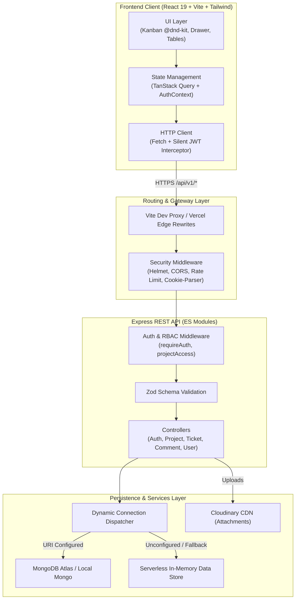
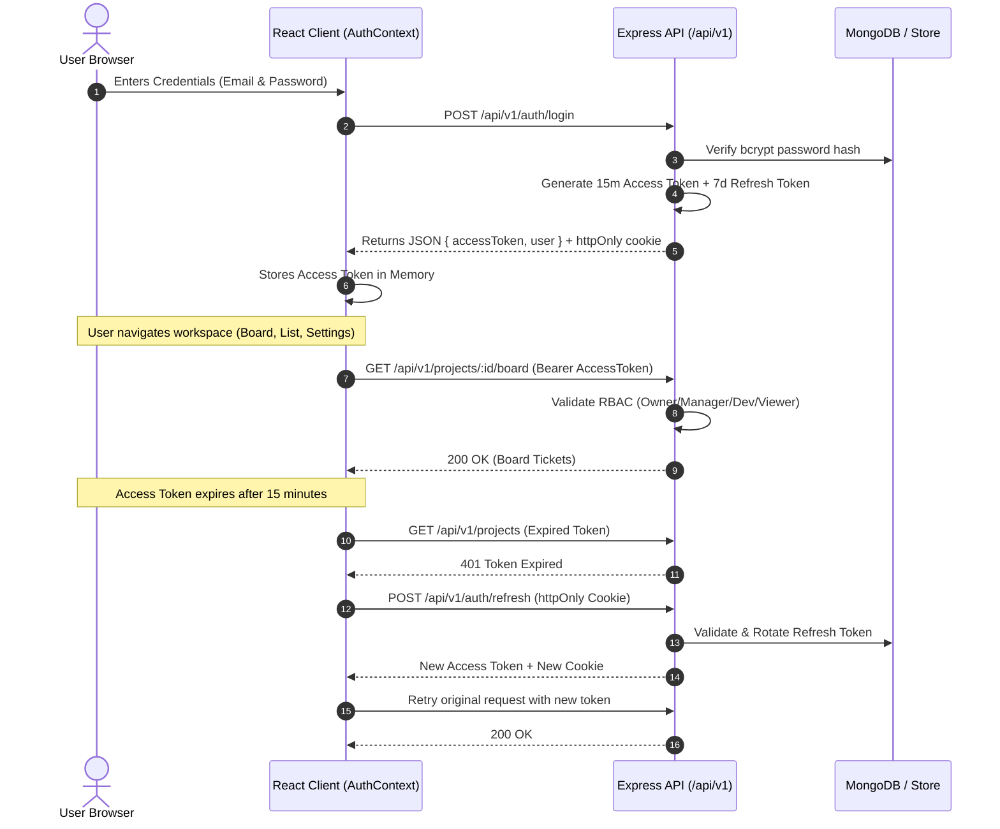

# TrackFlow — Modern Issue & Bug Tracker SaaS

<div align="center">

[](https://trackflow-saas.vercel.app)
[](https://nodejs.org/)
[](https://react.dev/)
[](https://expressjs.com/)
[](https://www.mongodb.com/)
[](https://tailwindcss.com/)
[](LICENSE)

**A high-velocity, Jira/Linear-inspired issue tracker featuring interactive Kanban drag-and-drop boards, strict server-side RBAC, threaded discussions, real-time filters, and enterprise-grade multi-tenant data isolation.**

[Explore Live Demo](https://trackflow-saas.vercel.app) • [Architecture](#-system-architecture) • [Features](#-key-features) • [Quick Start](#-quick-start) • [API Docs](#-api-endpoints)

</div>

---

## 🏛️ System Architecture

TrackFlow is designed as a modular, decoupled full-stack application deployable either as a traditional monolithic service or serverless cloud functions on Vercel.



### Authentication & Token Lifecycle Flow



---

## ✨ Key Features

- **🛡️ Strict Multi-Tenant Isolation:**
  - Every project, board, ticket, and metric is authoritatively scoped to project members.
  - Non-members attempting to access resources receive a `404 Not Found` to prevent metadata leakage.
- **🌱 Clean Zero-Data Onboarding:**
  - Newly registered users start completely empty: **0 projects, 0 tickets, 0 comments, 0 notifications**.
  - Intuitive empty states on the Dashboard, Projects directory, and Kanban columns with one-click creation actions.
- **🎯 Interactive Kanban Board:**
  - Fluid drag-and-drop powered by `@dnd-kit` across `To Do`, `In Progress`, and `Done` columns.
  - Floating midpoint fractional positioning (`p = (prev + next) / 2`) with automatic column rebalancing.
  - Full keyboard accessibility (Space to grab, Arrow keys to navigate, Space to drop).
  - Optimistic client updates with instantaneous UI responsiveness and rollback protection.
- **👥 Authoritative Role-Based Access Control (RBAC):**
  - Four granular roles:
    - **Owner:** Full project governance, member roles, key configuration, and project deletion.
    - **Manager:** Ticket management, member invitations, assignment, and status moves.
    - **Developer:** Creation, movement, and assignment of own assigned/unassigned tickets.
    - **Viewer:** Read-only access to boards, tickets, and threaded discussions.
- **💬 Threaded Discussions:**
  - One-level nested comment architecture with automatic reply flattening for clean conversation hierarchy.
  - Relative humanized timestamps, author avatar color badges, and delete capabilities.
- **🔍 Instant Debounced Search & Filtering:**
  - 300ms debounced search over ticket keys (`WEB-1`), titles, and descriptions.
  - Multi-criteria filtering by priority (`Low`, `Medium`, `High`, `Critical`), type (`Bug`, `Feature`, `Task`), and assignee.
  - URL query string synchronization for effortless view bookmarking and sharing.

---

## 📊 RBAC Permission Matrix

| Action | Owner | Manager | Developer | Viewer |
|:---|:---:|:---:|:---:|:---:|
| **View Project & Board** | ✅ | ✅ | ✅ | ✅ |
| **View Tickets & Comments** | ✅ | ✅ | ✅ | ✅ |
| **Create Ticket** | ✅ | ✅ | ✅ | ❌ |
| **Move Ticket Across Columns** | ✅ | ✅ | ✅ (Own / Unassigned) | ❌ |
| **Edit Ticket Details** | ✅ | ✅ | ✅ (Own / Unassigned) | ❌ |
| **Assign / Reassign Ticket** | ✅ | ✅ | ❌ | ❌ |
| **Delete Ticket** | ✅ | ✅ | ❌ | ❌ |
| **Add Comment** | ✅ | ✅ | ✅ | ❌ |
| **Manage Members & Roles** | ✅ | ✅ | ❌ | ❌ |
| **Edit Project Settings** | ✅ | ❌ | ❌ | ❌ |
| **Delete Project** | ✅ | ❌ | ❌ | ❌ |

---

## 💻 Tech Stack

### Frontend
- **Framework:** React 19 (SPA)
- **Tooling:** Vite 6
- **Styling:** Tailwind CSS 3.4
- **State & Data Fetching:** TanStack Query v5 (React Query)
- **Routing:** React Router v7 (Code-split microchunks via `React.lazy`)
- **Drag & Drop:** `@dnd-kit/core`, `@dnd-kit/sortable`, `@dnd-kit/utilities`
- **Form Validation:** React Hook Form + Zod
- **Icons & UI:** Lucide React, Sonner Toast Notifications

### Backend
- **Runtime:** Node.js 20+ (Native ES Modules)
- **Framework:** Express 4.21
- **Database ODM:** Mongoose 8.9 (MongoDB Atlas + In-Memory Fallback)
- **Security:** Helmet, CORS, Express-Rate-Limit, Cookie-Parser, bcryptjs
- **Validation:** Zod Schema Validation Middleware
- **Tokens:** JSON Web Tokens (`jsonwebtoken`) + SHA-256 Rotating Cookie Hashes

---

## ⚡ Quick Start

### Prerequisites
- Node.js >= 20.0.0
- npm >= 10.0.0
- MongoDB instance (Atlas connection string or local MongoDB daemon)

### 1. Clone the repository
```bash
git clone https://github.com/vinaybarnwal149-creator/Bug-Tracker.git
cd Bug-Tracker
```

### 2. Install dependencies
```bash
npm install
```

### 3. Setup environment variables
Copy the example environment configuration:
```bash
cp .env.example .env
cp server/.env.example server/.env
```

Edit `.env` or `server/.env` with your settings:
```env
PORT=5000
NODE_ENV=development
MONGODB_URI=mongodb://127.0.0.1:27017/trackflow
JWT_ACCESS_SECRET=your_super_secret_access_key_min_32_chars
JWT_REFRESH_SECRET=your_super_secret_refresh_key_min_32_chars
CLIENT_URL=http://localhost:5173
```

> **Note:** If `MONGODB_URI` is not configured or an external MongoDB is unavailable, TrackFlow automatically switches to its high-performance in-memory serverless store without throwing errors.

### 4. Run Development Server
```bash
# Starts Express API (:5000) and Vite Dev Server (:5173) concurrently
npm run dev
```

Open your browser at **`http://localhost:5173`**.

---

## 🧪 Testing

The test suite runs Vitest against real MongoDB instances (via `mongodb-memory-server`):

```bash
# Run all unit and integration tests
npm test

# Run backend test suite
npm run test --workspace=server

# Run backend smoke test script
npm run smoke --workspace=server
```

---

## 📡 API Endpoints

### Authentication (`/api/v1/auth`)
| Method | Endpoint | Description | Auth Required |
|:---|:---|:---|:---:|
| `POST` | `/login` | Authenticate user & issue access/refresh tokens | No |
| `POST` | `/register` | Create a brand-new account (starts with 0 data) | No |
| `POST` | `/refresh` | Silent refresh using rotating httpOnly cookie | Yes (Cookie) |
| `POST` | `/logout` | Invalidate active refresh token & clear cookie | Yes |
| `GET` | `/me` | Fetch currently authenticated user session | Yes (Bearer) |

### Projects (`/api/v1/projects`)
| Method | Endpoint | Description | Auth Required |
|:---|:---|:---|:---:|
| `GET` | `/` | List all projects the user is a member of | Yes |
| `POST` | `/` | Create a new project (auto-assigned Owner role) | Yes |
| `GET` | `/:projectId` | Fetch single project metadata & role | Yes |
| `PATCH` | `/:projectId` | Update title or description (Owner only) | Yes |
| `DELETE` | `/:projectId` | Cascade delete project and all tickets (Owner) | Yes |
| `GET` | `/:projectId/stats` | Aggregated ticket metrics & status counts | Yes |
| `GET` | `/:projectId/board` | Kanban columns with tickets sorted by position | Yes |
| `GET` | `/:projectId/tickets`| Paginated & filtered ticket list | Yes |
| `POST` | `/:projectId/tickets`| Create a new ticket with auto-increment key | Yes |

### Tickets & Comments (`/api/v1/tickets`)
| Method | Endpoint | Description | Auth Required |
|:---|:---|:---|:---:|
| `GET` | `/:ticketId` | Get ticket detail with reporter and assignee | Yes |
| `PATCH` | `/:ticketId` | Update ticket title, description, priority, type | Yes |
| `PATCH` | `/:ticketId/move` | Update status & recalculate Kanban position | Yes |
| `PUT` | `/:ticketId/assignee` | Assign ticket to project member | Yes |
| `DELETE` | `/:ticketId` | Delete ticket (Manager/Owner only) | Yes |
| `GET` | `/:ticketId/comments`| Fetch threaded comment hierarchy | Yes |
| `POST` | `/:ticketId/comments`| Add a root comment or reply to existing | Yes |

---

## 🔑 Demo Account Credentials

To quickly test the pre-seeded demo environment on the [Live Website](https://trackflow-saas.vercel.app):

- **Role:** Project Owner
- **Email:** `owner@demo.com`
- **Password:** `Password123!`

*(You can also click the single **"Auto-Fill Demo Account"** button on the Login page).*

---

## 📁 Repository Structure

```
.
├── api/                    # Vercel Serverless Function entry point (Express adapter)
├── client/                 # Frontend React SPA
│   ├── src/
│   │   ├── api/            # API client service layer & silent token refresh
│   │   ├── components/     # UI primitives, Kanban, Projects, Modals, Drawer
│   │   ├── context/        # React AuthContext session provider
│   │   ├── hooks/          # Custom hooks (useAuth, useDebounce, usePermissions)
│   │   ├── lib/            # Utilities, constants, and permission rules
│   │   └── pages/          # Landing, Login, Register, Dashboard, Board, ListView
│   └── package.json
├── server/                 # Backend REST API
│   ├── src/
│   │   ├── config/         # Database and environment variable loaders
│   │   ├── controllers/    # Request handlers for Auth, Projects, Tickets, Comments
│   │   ├── middleware/     # Auth, RBAC permissions, upload, error handlers
│   │   ├── models/         # Mongoose schemas (User, Project, Ticket, Comment)
│   │   ├── routes/         # Express routers & demo fallback router
│   │   ├── seed/           # Development database seeder
│   │   ├── utils/          # Token generator, API errors, position math
│   │   └── validators/     # Zod schema definitions
│   └── package.json
├── docs/                   # Full PRD and architecture specification documents
├── vercel.json             # Vercel routing, rewrites, and build configurations
└── README.md
```

---

## 📄 License

This project is licensed under the [MIT License](LICENSE).
